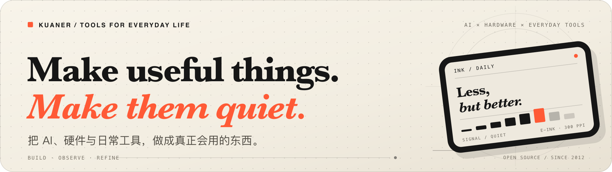

  <a href="https://github.com/kuaner">
    <picture>
      <source media="(max-width: 600px)" srcset="https://raw.githubusercontent.com/kuaner/kuaner/main/assets/mobile-hero.png">
      
    </picture>
  </a>

你好，我是 **Kuaner**。我喜欢把软件、硬件和 AI 缝在一起，做那些“本来就应该存在”的小工具：让 AI 拥有更长的上下文与自己的时间，让墨水屏只留下真正重要的信息，也让身边的设备重新顺手。

> 我偏爱低噪音的产品：不抢注意力，但在需要时刚好出现。

## 精选作品

### [duoduo ↗](https://github.com/openduo/duoduo)

一个长期运行的本地 Agent 环境。对话会结束，工作不应该结束。

### [inkBoard ↗](https://github.com/kuaner/inkBoard)

给 Android 墨水屏平板的 HOME 启动器。把手机式动画，换成一页安静的桌面。

### [inkFlow ↗](https://github.com/kuaner/inkFlow)

会持续更新财经快讯的墨水屏桌面摆件。只在真正重要时开口。

### [bambu-wiki ↗](https://github.com/kuaner/bambu-wiki)

把 Bambu Lab Wiki 变成 Agent 可以直接检索的 Markdown：先让机器读懂，再帮人回答。

---

## 更多作品

- [拼音闯关大冒险](https://github.com/kuaner/pinyin-adventure) — 给学拼音的孩子做的闯关练习，带自适应错题和间隔复习。
- [Apple Silicon 加速度计](https://github.com/kuaner/apple-silicon-accelerometer) — 用 Swift 读取 Apple Silicon Mac 内置传感器。
- [Bambu 安卓面板](https://github.com/kuaner/bambuDroid) — 在 Android 设备上看 Bambu Lab 打印机的实时状态。
- [MonsGeek WebHID 配置器](https://github.com/kuaner/monsgeek-webdriver) — 在浏览器里配置 MonsGeek M1W 键盘。
- [Duoduo Widgets](https://github.com/aidgets/duoduo-widgets) — 给 AI Agent 的交互式 Web Widgets。

---

## 工具箱

- **Agent / Web** — TypeScript / Node.js / MCP / Svelte / Vue
- **Apple** — Swift / SwiftUI / macOS / iOS
- **Devices** — ESP32 / ESP-IDF / Kotlin / C
- **Tinkering** — Python / Go / CadQuery / 3D printing

---

## 我的做法

1. **从摩擦开始** — 先找到一个真实的不顺手，不从技术栈倒推产品。
2. **先跑起来** — 尽快做出一版能每天使用的东西，让细节在真实场景里长出来。
3. **再安静下来** — 去掉不必要的动画、配置和打扰，直到它自然而然地待在那里。

---

## 联系

正在把 Agent 做得更耐久，把墨水屏做得更安静，也让日常工具重新顺手。

想聊 AI Agent、墨水屏、嵌入式设备，或者刚好有一个“应该已经存在”的小工具，欢迎来 GitHub 找我。

[查看全部公开仓库](https://github.com/kuaner?tab=repositories) · [访问 OpenDuo](https://openduo.ai)

 

  <em>Make it useful. Then make it quiet.</em>

